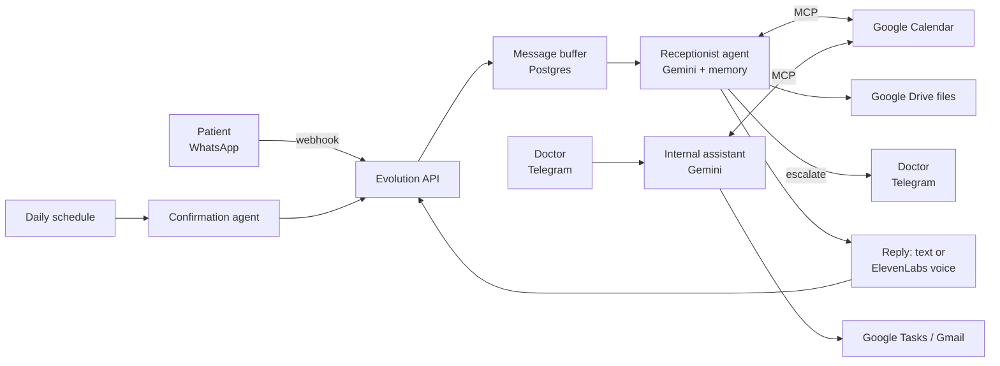

# AI Clinic Receptionist (n8n)

An AI receptionist that answers patients on WhatsApp, books and reschedules appointments in Google Calendar, and sends confirmations the day before. The doctor manages everything from a private assistant on Telegram.

Built as a set of [n8n](https://n8n.io) workflows with Google Gemini, Evolution API (WhatsApp) and an MCP server for Google Calendar.

## What it does

**For patients (WhatsApp)**
- Understands text and voice messages (audio is transcribed with Gemini)
- Answers in the same format it received: text, or a voice reply generated with ElevenLabs
- Books, moves and cancels appointments, only confirming after the calendar tool succeeds
- Sends files from Google Drive (price lists, pre-exam instructions, etc.)
- Hands the conversation to a human on Telegram when it can't help
- Shows "typing…" / "recording…" and marks messages as read, so it feels like a real person

**Every day**
- A confirmation agent reads tomorrow's appointments and messages each patient to confirm

**For the doctor (Telegram)**
- Reschedule appointments by text or voice ("move all my 3pm patients to Friday")
- Create Google Tasks reminders and read Gmail
- Shares memory with the WhatsApp agent, so both know what the other did

## How it works

A few details worth knowing:
- **Message buffering:** patients often send several short messages in a row. Incoming messages go to a Postgres queue, the flow waits ~16 s, then answers all of them at once. No RabbitMQ needed.
- **Calendar as an MCP server:** create, search, update and delete events are exposed through n8n's MCP trigger, and both agents use the same server.
- **Shared memory:** n8n has no built-in way to share memory between agents, so a `save_memory` tool writes to the same Postgres chat history.

## Workflows

| File | Role |
|---|---|
| `1. Secretária.json` | Main WhatsApp receptionist + daily confirmation agent |
| `2. MCP Google Calendar.json` | MCP server exposing Google Calendar tools |
| `3. Baixar e enviar arquivo do Google Drive.json` | Downloads a Drive file and sends it on WhatsApp |
| `4. Atualizar status.json` | Sends "typing…" / "recording…" presence in parallel |
| `5. Assistente interno.json` | Doctor's assistant on Telegram |

## Setup

Requirements:
- n8n (self-hosted)
- Postgres (Supabase works) for the message queue and chat memory
- [Evolution API](https://doc.evolution-api.com/) instance + the [n8n-nodes-evolution-api](https://github.com/oriondesign2015/n8n-nodes-evolution-api) community node
- Google Gemini API key, ElevenLabs API key (optional, for voice replies)
- Google OAuth credentials (Calendar, Drive, Tasks, Gmail) and a Telegram bot

Steps:
1. Import workflows 2 to 5 first, then `1. Secretária.json`.
2. Create the credentials above in n8n and select them in each node.
3. Replace the placeholders (`seu-n8n.exemplo.com`, `sua-evolution-api.exemplo.com`, `SEU_ID_DA_AGENDA`, `SEU_ID_DA_PASTA`, `SEU_TELEGRAM_CHAT_ID`) with your own values.
4. While testing, replace `55DDDNUMERO` in the first filter node with your own phone number, so the agent only answers you.
5. Activate the workflows. Message buffering only works in production mode.

## Stack
n8n · Google Gemini · Evolution API (WhatsApp) · MCP · Google Calendar / Drive / Tasks / Gmail · ElevenLabs · Postgres · Telegram
